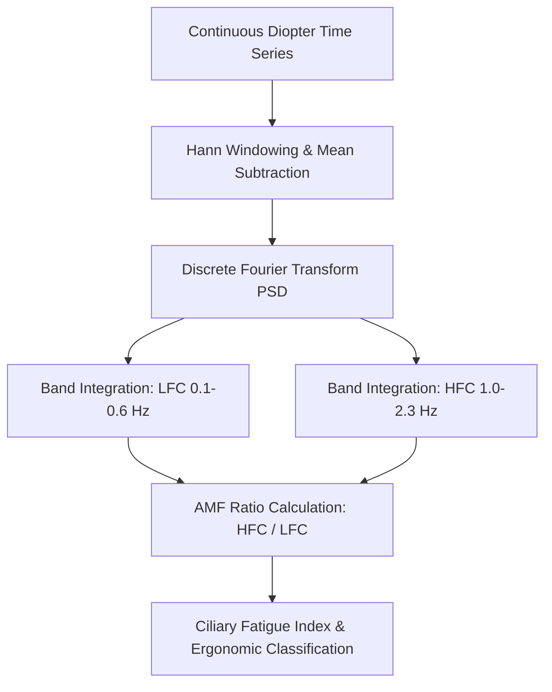

# Ocular Accommodative Microfluctuations (AMF) Skill

[](LICENSE)
[](https://www.python.org/)
[](https://openclaw.org/)
[](https://alphapark.ai/)
[](https://modelcontextprotocol.io/)

Dynamic Ocular Accommodative Microfluctuations (AMF) Spectral Analyzer. Evaluates crystalline lens focal oscillations, low-frequency component (LFC: <0.6 Hz), and high-frequency component (HFC: 1.0-2.3 Hz) to quantify visual fatigue and ciliary spasm.



## Features
- **Zero PIP Dependencies**: Implemented strictly with Python Standard Library (`math`, `json`, `sys`, `typing`).
- **Fourier Spectral Decomposition**: Hann-windowed discrete power spectrum analysis.
- **Objective Ergonomics**: Identifies ciliary hypertonicity and digital screen visual fatigue before subjective eyestrain symptoms escalate.
- **Dual Architecture**: Supports native Python import and Model Context Protocol (MCP) JSON-RPC 2.0 stdio interface.

## Quickstart
```bash
python example_usage.py
```

## License
Apache-2.0
